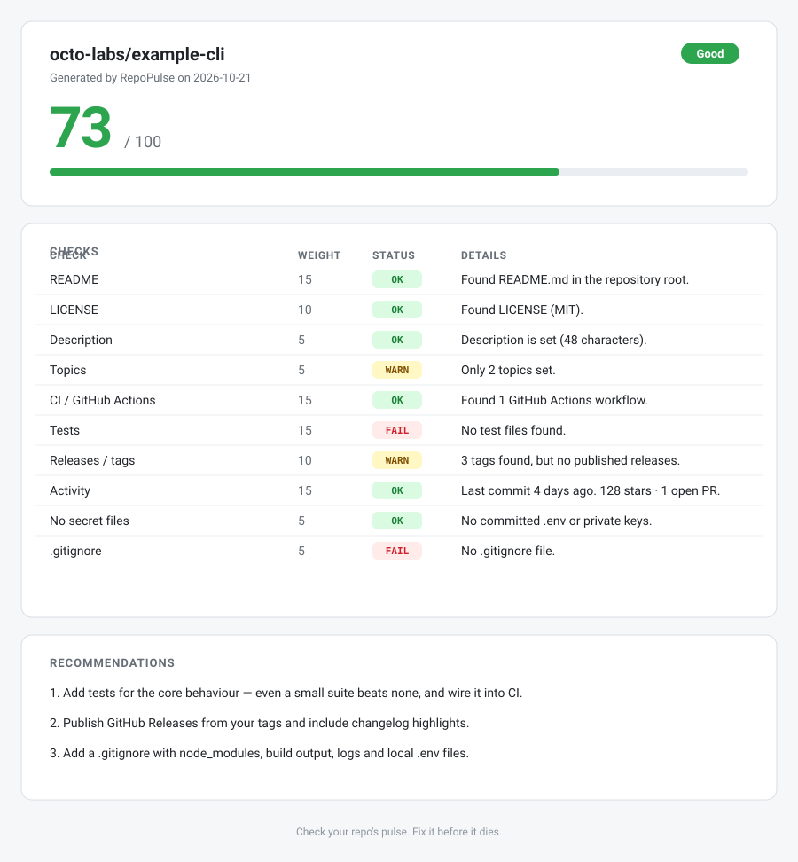

# RepoPulse

> **Check your repo's pulse. Fix it before it dies.**

RepoPulse scores the health of a GitHub repository in about 30 seconds. It looks at the
things that make a project trustworthy — docs, license, CI, tests, releases, recent
activity and leaked secrets — then gives you a **0–100 score**, a list of problems, the
three fixes that matter most, a **single-file HTML report** and an **SVG badge** for your
README.

No server, no database, no sign-up. One command.

```console
$ npx repopulse check sindresorhus/got

  RepoPulse  https://github.com/sindresorhus/got

  100/100   Excellent

       Check                 W   Status  Details
  ──────────────────────────────────────────────
       README                15  OK      Found readme.md in the repository root.
       LICENSE               10  OK      Found license (MIT).
       Description           5   OK      Description is set (63 characters).
       Topics                5   OK      6 topics set: http, http-client, ...
       CI / GitHub Actions   15  OK      Found 1 GitHub Actions workflow.
       Tests                 15  OK      Found 64 test files (e.g. test/abort.ts).
       Releases / tags       10  OK      100+ releases published.
       Activity              15  OK      Last commit 8 days ago. 14953 stars ...
       No secret files       5   OK      No committed .env, private keys or ...
       .gitignore            5   OK      Found .gitignore in the repository root.

  Nothing to fix — this repository is in great shape.
```

## Preview



<!-- Placeholder for a real screenshot: run `npx repopulse check owner/repo --html report.html`,
     open report.html and replace docs/report-preview.svg with the screenshot. -->

## Install

Node.js **20 or newer** is required.

```bash
# run without installing
npx repopulse check owner/repo

# or install globally
npm install -g repopulse
repopulse check owner/repo
```

From a source checkout:

```bash
git clone https://github.com/ScovilDev/RepoPulse.git
cd RepoPulse
npm install
npm run build
node dist/cli.js check owner/repo
```

## Usage

```bash
# 1. terminal report
npx repopulse check owner/repo

# 2. self-contained HTML report
npx repopulse check owner/repo --html report.html

# 3. SVG badge for your README
npx repopulse badge owner/repo --output repopulse.svg

# 4. machine-readable JSON
npx repopulse check owner/repo --json
```

`owner/repo` also accepts a URL: `repopulse check https://github.com/owner/repo`.

Then embed the badge in your README:

```markdown

```

### Commands

| Command | Description |
| --- | --- |
| `repopulse check <owner/repo>` | Score the repository and print the report |
| `repopulse check <owner/repo> --json` | Print the report as JSON (nothing else on stdout) |
| `repopulse check <owner/repo> --html <path>` | Also write a single-file HTML report |
| `repopulse badge <owner/repo> --output <path>` | Write an SVG score badge (`-o` for short) |
| `repopulse --version` / `--help` | Version and usage |

### GitHub token

RepoPulse works **without a token** on public repositories (60 requests/hour).
For private repositories, CI usage, or to avoid rate limits (5000 requests/hour),
set a token:

```bash
export GITHUB_TOKEN=ghp_...   # GH_TOKEN also works
npx repopulse check owner/repo
```

You can also pass `--token <token>`. The token is read from the environment only —
RepoPulse never writes it anywhere.

### Exit codes

| Code | Meaning |
| --- | --- |
| `0` | Report produced (regardless of score) |
| `1` | Invalid arguments, unknown repository, or GitHub API error |

Errors are printed to **stderr** with a hint, so `--json` output on stdout stays valid.

## What gets checked

| Check | Weight | OK | WARN | FAIL |
| --- | ---: | --- | --- | --- |
| README | 15 | a README file in the repository root | — | missing |
| LICENSE | 10 | license file or license detected by GitHub | — | missing |
| Description | 5 | 10+ characters | shorter | empty |
| Topics | 5 | 3+ topics | 1–2 topics | none |
| CI / GitHub Actions | 15 | workflow in `.github/workflows` | another CI provider only | none |
| Tests | 15 | test files found | — | none |
| Releases / tags | 10 | published releases | tags without releases | neither |
| Activity | 15 | commit ≤ 90 days ago | ≤ 365 days | older, or no commits |
| No secret files | 5 | no `.env`, keys, credentials | — | secret-like file committed |
| `.gitignore` | 5 | present | — | missing |

**Total: 100 points.** A passing check earns its full weight, a warning earns half,
and a failure earns nothing.

### Critical problem cap

If a secret-like file is committed to the repository (`.env`, `id_rsa`, `credentials`,
`*.pem`, …), the score is **capped at 40** and the status is always `Critical` — no
amount of documentation makes up for a leaked key. Template files such as `.env.example`
are allowed, and `.pub` keys are not treated as secrets.

### Status bands

| Score | Status |
| --- | --- |
| 85–100 | `Excellent` |
| 70–84 | `Good` |
| 50–69 | `Needs work` |
| 0–49 | `Critical` |

Badge colours: **green** 70–100, **yellow** 50–69, **red** 0–49.

## JSON output

`--json` prints a stable schema (`null`s never appear; arrays may be empty):

```json
{
  "repo": "sindresorhus/got",
  "score": 100,
  "status": "Excellent",
  "checks": [
    {
      "id": "readme",
      "title": "README",
      "status": "ok",
      "weight": 15,
      "message": "Found readme.md in the repository root.",
      "recommendation": "Keep the README updated with install and usage instructions."
    }
  ],
  "recommendations": []
}
```

- `score` — integer 0–100 (already capped when a critical problem exists).
- `status` — `Excellent` | `Good` | `Needs work` | `Critical`.
- `checks[].status` — `ok` | `warn` | `fail`; `checks[].id` is stable and safe to key on.
- `recommendations` — up to three strings, highest-impact fixes first.

## HTML report

`--html report.html` writes one self-contained file: inline CSS, no CDN, no scripts, no
external fonts. It opens offline and can be attached to a CI artifact or a review comment.

## How it works

RepoPulse makes a handful of GitHub REST calls per run:

1. `GET /repos/{owner}/{repo}` — description, topics, license, stars, default branch.
2. `GET /repos/{owner}/{repo}/git/trees/{branch}?recursive=1` — every file path, used by
   the README / LICENSE / CI / tests / secrets / .gitignore checks.
3. Releases, tags and the latest commit.
4. Two search queries for open issues and open pull requests.

Checks are pure functions over that snapshot, so they are trivial to unit test.

```
src/
  cli.ts            command parsing, output wiring
  github.ts         octokit client, snapshot fetching, API error mapping
  checks/           one file per check (readme, license, ci, tests, ...)
  score.ts          weighting, critical cap, status bands, recommendations
  report/
    console.ts      terminal report (colours only on a TTY, respects NO_COLOR)
    html.ts         single-file HTML report
    svg.ts          shields-style SVG badge
  types.ts          shared types + public JSON schema
tests/              vitest tests for scoring, checks and renderers
```

## Development

```bash
npm install
npm run build       # tsc → dist/
npm test            # vitest run
npm run typecheck   # includes tests/
npm run test:watch
```

CI runs typecheck, tests and build on Node 20 and 22 for every push and pull request,
and smoke-tests the CLI.

## Limitations (MVP)

- Only GitHub is supported (no GitLab or Bitbucket).
- "Tests" means test *files were found*, not that they pass or that coverage is high.
- Repositories with more than 100 000 files are scanned from a truncated tree; the
  snapshot marks this with `truncated`, and file-based checks may miss something.
- Activity is based on the last commit date only.

## License

[MIT](LICENSE)
